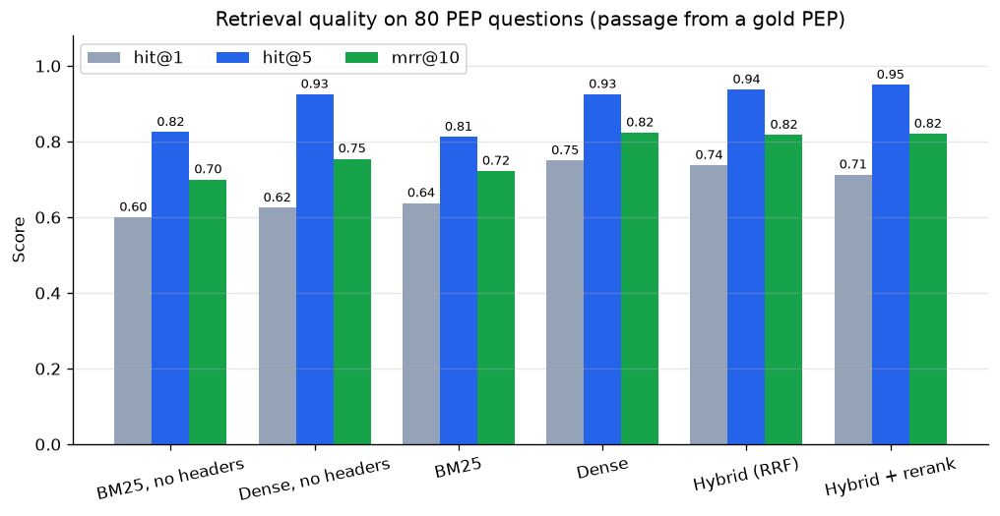
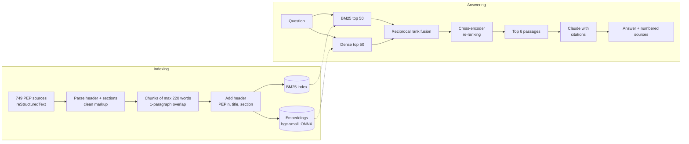

# Ask the PEPs

[](https://github.com/fareszid/pep-rag-assistant/actions/workflows/ci.yml)

[](LICENSE)

A RAG assistant for questions about Python's design, like *"Why was the walrus operator
added?"* or *"How do I type a decorator that keeps the wrapped function's signature?"*. Answers
come from the Python Enhancement Proposals (PEPs), and every claim links to the PEP section it
comes from.

The focus is on the retrieval side and on measuring it: keyword + semantic search, rank fusion,
cross-encoder re-ranking, an 80-question benchmark that compares each stage, and Claude's
built-in citations so answers can be checked.

**Result:** on 80 labelled questions, the full pipeline puts a passage from the right PEP in the
top 5 for **95%** of questions (MRR@10 0.82), against 81% for keyword search alone. Adding a
"PEP title › section" header to each chunk raised the top-1 accuracy of semantic search from
**63% to 75%**.



## How it works



| Stage | Choice | Why |
|---|---|---|
| Corpus | 744 PEPs, 16,752 passages | Public domain, technical, and every answer can be checked on peps.python.org |
| Chunking | Split on RST sections, max 220 words, one paragraph of overlap | Passages stay on one topic and keep a link to their section |
| Chunk headers | Each passage is indexed as `PEP 572 – Assignment Expressions › Rationale` + text | Passages deep inside a PEP often never mention what the PEP is about |
| Keyword search | BM25, written from scratch on scipy sparse matrices | Exact names (`__init_subclass__`, `TypeVarTuple`) matter in technical text |
| Semantic search | `BAAI/bge-small-en-v1.5` with ONNX Runtime (fastembed) | Handles paraphrases; no PyTorch needed, runs on any CPU |
| Fusion | Reciprocal rank fusion (k = 60) | Merges the two rankings without calibrating BM25 against cosine scores |
| Re-ranking | `ms-marco-MiniLM-L-6-v2` cross-encoder on the top 50 | Reads the question and the passage together, so the final order is better |
| Generation | Claude Opus 5.5 with `search_result` blocks | Citations come back as data (source, title, quoted text), no "[1]" prompt tricks |

## Retrieval benchmark

[`eval/questions.jsonl`](eval/questions.jsonl) has 80 questions phrased the way a developer would
ask them (not copied from PEP titles), each labelled with the PEP or PEPs that answer it. They
cover syntax, typing, packaging, runtime, standard library, style and process. A retrieved
passage counts as relevant if it comes from one of the labelled PEPs.

| Configuration | Hit@1 | Hit@3 | Hit@5 | Hit@10 | MRR@10 | Latency (p50, CPU) |
|---|---|---|---|---|---|---|
| BM25, no chunk headers | 60.0% | 77.5% | 82.5% | 90.0% | 0.700 | 0.8 ms |
| Dense, no chunk headers | 62.5% | 87.5% | 92.5% | 95.0% | 0.755 | 3.5 ms |
| BM25 | 63.8% | 78.8% | 81.2% | 91.2% | 0.722 | 0.8 ms |
| Dense | **75.0%** | 86.2% | 92.5% | 97.5% | **0.824** | 3.4 ms |
| Hybrid (RRF) | 73.8% | 88.8% | 93.8% | 95.0% | 0.818 | 4.0 ms |
| **Hybrid + re-rank** (default) | 71.2% | **93.8%** | **95.0%** | **98.8%** | 0.821 | 847 ms |

What I take from it:

1. **Semantic search beats keyword search** on natural questions: 75% vs. 64% top-1. BM25 is
   still useful in the hybrid for exact identifiers.
2. **Chunk headers are the cheapest improvement.** Adding the PEP title and section to each
   chunk took dense top-1 accuracy from 62.5% to 75% (10 more questions) at no query-time cost.
3. **Re-ranking helps recall more than the first hit.** It gives the best Hit@3/5/10 (95% in
   the top 5, 98.8% in the top 10) but a slightly lower Hit@1 than dense search, and adds about
   0.85 s per query on a CPU. Claude reads the top 6 passages, so recall at 5-6 is what matters
   for answers, and re-ranking is the default there. Dense-only is the fast option for search.
4. **Most errors are near misses.** Only 4 questions have no right passage in the top 5, and 1 in
   the top 10. When the first hit is wrong, it is usually a closely related PEP (a superseded
   proposal or a follow-up PEP on the same feature). Packaging (78% Hit@5) and typing (89%) are
   the hardest categories because many PEPs there cover the same concepts.
5. One question is 1.25 points, so gaps of a few points between the top configurations are
   noise. The gaps to BM25 and to indexing without headers are not.

Per-question results are in [`reports/retrieval_eval_details.csv`](reports/retrieval_eval_details.csv).

## Answers with citations

```bash
export ANTHROPIC_API_KEY=...        # from https://console.anthropic.com
pepbot ask "Why was the walrus operator added?"
```

The question and the six best passages are sent to Claude as `search_result` blocks with
citations turned on. Every sentence that uses a passage comes back with a citation (URL, title,
quoted text), which becomes a numbered footnote linking to the PEP section. The request uses
Claude Opus 5.5 at `medium` effort, with server-side fallback enabled so a declined request is
retried on Anthropic's recommended fallback model.

`pepbot eval --generation` also asks Claude every benchmark question and reports how many answers
cite one of the right PEPs (this uses API credits).

Without an API key, `pepbot ask "..." --no-llm` and the web app still show the retrieved
passages.

### Web app

```bash
make app        # streamlit run app/streamlit_app.py
```

A chat interface with example questions, a retrieval mode selector, expandable citations with
the quoted text, and the retrieved passages under each answer.

## Run it

```bash
git clone https://github.com/fareszid/pep-rag-assistant.git
cd pep-rag-assistant
python -m venv .venv && source .venv/bin/activate
make install    # pip install -e ".[app,dev]"
make ingest     # download the PEP repository and build 16k passages (~10 s)
make index      # embed the passages on CPU (two versions for the comparison, ~25 min)
make eval       # retrieval benchmark, offline
make test       # 29 tests, offline
```

## Tests

- **Parsing and chunking**: header continuation lines, section detection, markup cleanup, chunk
  size and overlap, section anchors.
- **Retrieval**: BM25 ranking and IDF, RRF arithmetic, each retrieval mode and re-ranking, with a
  deterministic hashing embedder instead of the neural model.
- **Generation**: the request goes through the real Anthropic SDK with a mocked HTTP transport.
  The test checks the JSON body (model, search_result blocks, citations, effort, fallback
  header) and that a response with citations becomes numbered sources. Refusals are handled.
- **Evaluation**: Hit@k and MRR on hand-computed examples.

## Project structure

```
├── src/pepbot/
│   ├── ingest.py      # download, RST parsing, cleanup, chunking
│   ├── bm25.py        # Okapi BM25 on sparse matrices
│   ├── retrieve.py    # embeddings, dense search, RRF, cross-encoder, Retriever
│   ├── generate.py    # Claude request with search_result blocks, citation parsing
│   ├── evaluate.py    # retrieval and generation benchmarks
│   └── cli.py         # pepbot ingest | index | ask | eval
├── app/               # Streamlit chat interface
├── eval/              # 80 labelled questions
├── reports/           # benchmark results and figure
└── tests/
```

## Limitations and next steps

- The benchmark is small (80 questions) and labels whole PEPs, not passages, so small gaps
  between methods are noise.
- Some "misses" retrieve a closely related PEP first, e.g. PEP 622 (the original pattern
  matching proposal) before PEPs 634-636. Graded relevance labels would measure this more fairly.
- Next: an LLM-judged faithfulness score for the answers, query rewriting for very short
  questions, and a vector database (e.g. pgvector) if the corpus outgrows memory.

## Data

PEP texts from [python/peps](https://github.com/python/peps), placed in the public domain or
under CC0-1.0 by their authors. They are downloaded at runtime and not stored in this
repository.
